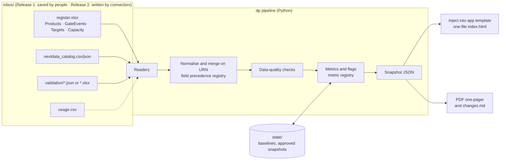

# Data Product Dashboard v1: Engineering Plan

> **Archived plan (Oct 5, 2026).** Kept for the reasoning behind decisions; it is not maintained. Where it differs from the code, the code is current: see `README.md`, `docs/metric-definitions.md` and `docs/adr/`.

Oct 5, 2026 · @K · Revision 2 · Companion to [build-plan-v2.md](build-plan-v2.md)

**What changed in revision 2**

- **Builders are AI agents.** The builders are four AI agents with merged roles that don't overlap. Three human roles make the decisions only humans should make.
- **Release 1 reads local files.** It runs on files dropped into one folder. SharePoint, NextData, Snowflake and hosting become Release 2 connectors that write the same files, so the core doesn't change.
- **Fewer moving parts.** No server, no cloud permissions and no service identities are needed to ship Release 1.
- **Metrics live in a registry.** Adding a KPI means adding a registry entry, a function and a test.

## 1. Goal and definition of done

Release 1 turns a folder of weekly files into a signed-off executive pack. The pack is an interactive one-file dashboard plus a one-page PDF, built on the Data Product Governance Framework gates (G1 Intake to G6 Retire). It covers Commercial, G&A, R&D, and TechOps & Quality.

Release 1 is done when all of the following are true:

1. The program team can run one command on a laptop to turn the inbox folder into a draft pack with a data-quality report, and a second command to approve it.
2. The dashboard opens from a single HTML file with no server. It shows the executive overview, a domain view and the product list, and every number links to the products behind it.
3. A one-page PDF of the executive overview and a three-line "what changed" note are produced for the weekly Teams post.
4. Two weekly dry runs reconcile with the EDP Success Team Weekly Update and the Confluence Commercial Data Product Inventory, with every difference explained.
5. Every metric rule has a passing acceptance test written from the human-approved definitions.

## 2. Scope

| Release 1 · local files | Release 2 · connected and hosted |
| --- | --- |
| Inbox folder of Excel/CSV/JSON files | Connectors that write the same inbox files from SharePoint lists, NextData API, the validation tool and Snowflake |
| `dp` command-line tool (check, build, approve, export) | Scheduled runs (GitHub Actions) |
| One-file HTML dashboard and PDF one-pager | Hosted app behind Entra ID sign-in |
| Snapshot history in a local state folder | Snapshot history in a versioned SharePoint library |
| "What changed" text for a manual Teams post | Automatic Teams post through a Workflows webhook |
| Self-reported usage, labelled | Snowflake usage |

Out of scope in both releases: gate checklists, rule-level validation detail, editing data inside the app.

## 3. Design principles

These keep the build simple now and make it easy to extend later.

1. **Two contracts and nothing else shared.** Files go into the *inbox contract*; the *snapshot contract* comes out. Readers, metrics and UI only depend on these.
2. **Sources only ever write files.** Today a person saves a file into the inbox; later a connector does. The pipeline never calls a source system directly.
3. **Everything reproducible.** Running `dp build` with the same inbox, week and state folder always produces the same snapshot.
4. **Registries instead of code changes.** Metrics, flags and field precedence are declared in YAML registries. Adding a source, KPI or flag is additive.
5. **Static output.** The dashboard is one HTML file with the snapshot embedded. There's no server, no browser storage and no spreadsheet parsing in the browser.
6. **Smallest stack that works.** The weekly run needs Python only. Node is needed only to rebuild the app template when the UI changes.

## 4. Architecture



## 5. Inbox contract (Release 1)

The inbox can be a OneDrive-synced folder, so the program team works on files kept in SharePoint while the pipeline still sees a local folder.

```
inbox/
├── register.xlsx              # template with 4 sheets (or the 4 CSVs below)
│   ├── Products
│   ├── GateEvents
│   ├── Targets
│   └── Capacity
├── nextdata_catalog.csv|json  # optional · NextData export
├── validation/                # optional · repo validation tool runs (JSON, or current Excel reports)
└── usage.csv                  # optional · Release 2 Snowflake extract
state/                         # written only by dp
├── baselines.csv
└── snapshots/2026-W43.json
out/2026-W43/
├── index.html                 # one-file dashboard, snapshot embedded
├── snapshot.json
├── exec-one-pager.pdf
├── changes.md
└── dq-report.html
```

| Table | Key | Columns | Maintained by |
| --- | --- | --- | --- |
| Products | `urn` | `urn, name, domain, pod, dpo, planned_next_gate_date, planned_ga_date, named_consumers, input_products, active_users_30d, first_consumer_date, dpo_comment, reviewed_on, cancelled_on` | DPOs (program team for identity columns) |
| GateEvents | `urn, gate, date_passed` | `urn, gate (G1–G6), date_passed, g5_path (scope change / bug fix), evidence_url` | DPOs |
| Targets | `domain, quarter` | `domain, quarter (2026-Q4), certification_target` | Program lead |
| Capacity | `domain, week` | `domain, week (2026-W43), onboarded, enrolled, qualified` | Success team |
| NextData catalog | `urn` | `urn, name, domain, status, owner, input_ports, output_ports` | NextData export |
| Validation runs | `urn, run_at` | `urn, run_at, catalogue_version, gate_target, checks_run, checks_passed, p1_findings` | Validation tool |
| Usage | `urn` | `urn, active_users_30d, consuming_products_30d, first_consumer_date, source` | Release 2 |

**Conventions**

- Dates are ISO (`YYYY-MM-DD`).
- Lists are separated by semicolons.
- URNs follow NextData; products not yet registered there use a `pending:` prefix.
- Headers are matched case-insensitively.
- Unknown columns are ignored with a warning.

**Field precedence** (`registry/fields.yaml`) decides which source wins when two inbox files hold the same field. Release 2 only adds entries.

```yaml
domain:            [nextdata_catalog, products]
active_users_30d:  [usage@snowflake, products@self-reported]
first_consumer_date: [usage@snowflake, products@self-reported]
input_products:    [nextdata_catalog.input_ports, products]
```

**Plan slips and baselines without a version history.** Local files have no edit history, so `dp` compares each plan date with the last approved snapshot. A change to a later date for the same gate counts as one slip. The first plan seen for a gate is written once to `state/baselines.csv`. Slips are therefore counted per week, which is enough for an executive view.

## 6. Command-line tool

```
dp check   --inbox ./inbox                     # read and validate files, print data-quality report
dp build   --inbox ./inbox --week 2026-W43     # draft snapshot, index.html (DRAFT watermark), dq-report.html
dp approve --week 2026-W43 --by "Program lead" # stamp sign-off, copy snapshot to state/, rebuild without watermark
dp export  --week 2026-W43                     # exec-one-pager.pdf and changes.md
dp preview --week 2026-W43                     # open index.html in the default browser
```

- `dp build` refuses to produce a pack if a blocker is found (section 9).
- `dp approve` refuses unless the draft has been rebuilt since the latest inbox change.
- The app template (`app/dist/template.html`) is built once with Vite and a single-file plugin. `dp build` injects the snapshot into a `<script type="application/json" id="snapshot">` tag, escaping `</` sequences.
- The PDF is printed from the executive route with Playwright (Chromium). If Playwright isn't installed, `dp export` prints the steps to install it.

## 7. Snapshot contract

`schema/snapshot.schema.json` is the single definition. TypeScript types are generated from it, and the Python models are checked against it in CI.

```ts
interface Snapshot {
  schemaVersion: "1.0";
  weekId: string;                 // "2026-W43"
  asOfDate: string;
  generatedAt: string;
  signOff: { status: "draft" | "approved"; approvedBy?: string; approvedAt?: string };
  sources: { name: string; file: string; asOf: string; status: "ok" | "stale" | "missing"; rows: number }[];
  metrics: MetricValue[];         // from the metric registry, org and domain level
  products: ProductRow[];
  trend: { quarter: string; domain: string; certified: number; target: number | null }[];
  changes: string[];              // max 3
  dataQuality: { severity: "blocker" | "warning"; urn?: string; rule: string; message: string }[];
}

interface MetricValue {
  id: string;                     // registry id, e.g. "certified_qtd"
  scope: "org" | string;          // "org" or a domain name
  value: number | null;
  n?: number; values?: number[];  // medians: n, and raw values when n < 3
  target?: number | null;
  source: "register" | "self-reported" | "snowflake" | "nextdata" | "validation";
  flag?: "BEHIND" | null;
}

interface ProductRow {
  urn: string; name: string; domain: string; pod?: string; dpo?: string;
  stage: "Inception" | "Discovery" | "Design/Develop" | "Test/Launch" | "Operate/Support" | "Retire";
  status: "In design" | "In build" | "In certification" | "Live" | "Live · in revision" | "Retired" | "Cancelled";
  gates: { gate: string; date: string; iteration: number; evidenceUrl?: string }[];
  firstG4Date?: string; daysInStage: number;
  nextGate?: { gate: string; plannedDate: string; baselineDate: string; slips: number; overdueDays: number };
  plannedGA?: { plannedDate: string; baselineDate: string; slips: number };
  inputProducts: string[]; consumedByProducts: string[]; namedConsumers: number;
  activeUsers30d?: { value: number; source: string };
  firstConsumerDate?: { value: string; source: string };
  validation?: { lastRun: string; p1Findings: number; firstRunPass: boolean };
  flags: { code: string; reason: string }[];
  dpoComment?: string; reviewedOn?: string;
}
```

Because metrics are a list of registry values rather than fixed fields, a new KPI needs no schema change. The UI renders any registry metric with the generic tile and table components.

## 8. Metrics

### 8.1 Metric registry

`registry/metrics.yaml` declares every metric. The executive page shows only entries with `exec_tile: true`. All others appear on the domain view or stay hidden until leadership selects them.

```yaml
- id: certified_qtd
  label: Certified this quarter
  definition: Products passing G4 Certify (GA) for the first time in the current quarter
  levels: [org, domain]
  unit: count
  compare_to: target
  exec_tile: true
  fn: metrics.headline.certified_in_quarter
- id: cycle_time_g1_g4
  label: Median G1→G4
  definition: Days from G1 Intake to first G4, products certified in the trailing 182 days
  levels: [org, domain]
  unit: days
  min_n: 3
  exec_tile: true
  fn: metrics.headline.cycle_time
```

Flags are declared the same way in `registry/flags.yaml` (code, level, rule function, reason template, whether coloured).

### 8.2 Lifecycle rules

- Order gate events by date. Iteration 1 starts at G1, and each G5 starts a new iteration.
- `firstG4Date` is the earliest G4 event.
- The status comes from the most recent event:

| Most recent event | Stage | Status |
| --- | --- | --- |
| None | Inception | In design |
| G1 | Discovery | In design |
| G2 | Design/Develop | In build |
| G3 | Test/Launch | In certification |
| G4 | Operate/Support | Live |
| G5 (scope change / bug fix) | Discovery / Design/Develop | Live · in revision (if previously G4) |
| G6 | Retire | Retired |
| `cancelled_on` set | unchanged | Cancelled |

### 8.3 Selected metrics (leadership) and flags

| Registry id | Rule | Edge cases |
| --- | --- | --- |
| `certified_qtd` | Count of products with `firstG4Date` in the quarter | Re-certifications after G5 are counted separately |
| `cycle_time_g1_g4` | Median `firstG4Date − G1`, trailing 182 days | n < 3 shows values; missing G1 excluded with a warning |
| `time_to_first_consumer` | Median `firstConsumerDate − G1`, trailing 182 days | Source label carried through |
| `active_users_median` | Median `activeUsers30d` over Live products | People are not summed across products |
| `inter_product_share` | Share of Live products declared as input by another active product | Self-references ignored |
| `certified_unused` | Live 60+ days, 0 users and no consuming product | Missing usage is a warning, not a flag |
| `in_flight_age` (domain view) | Median `asOf − G1` for products with G1 and no G4 | Prevents survivorship bias |
| `g4_forecast` (domain view) | Not yet certified, planned GA in current quarter, on or after `asOf`, not overdue | — |

| Flag | Level | Rule | Coloured |
| --- | --- | --- | --- |
| BEHIND | Domain | `certified_qtd + g4_forecast < target` | Yes |
| OVERDUE | Product | `asOf > planned_next_gate_date + 14 days` | Yes |
| SLIPPING | Product | Planned GA moved later 2+ times since baseline | Yes |
| NO_DPO | Product | At or past Discovery and no DPO | No |
| NOT_UPDATED | Product | `reviewed_on` older than 14 days | No |
| UNUSED | Product | `certified_unused` | No |
| PENDING_URN | Product | URN starts with `pending:` | No |

KPIs considered but not selected by leadership are listed in the build plan v2. Each has a registry id reserved, so it can be switched on without code changes beyond its function and test.

## 9. Data-quality checks

| Severity | Rule |
| --- | --- |
| Blocker | Missing required sheet or column; unreadable file |
| Blocker | Duplicate URN; gate events out of order or in the future; G2–G4 without G1 |
| Blocker | DPO comment matches screening patterns (email, phone, ID-like strings, health terms) |
| Blocker | Snapshot fails schema validation |
| Warning | Gate event without evidence link; no plan for the next gate, or a plan for a gate already passed |
| Warning | URN not in NextData catalog; domain differs from NextData; NextData status disagrees with derived stage |
| Warning | Live product without usage figure; validation run older than 14 days for a product in Test/Launch |
| Warning | Optional inbox file missing or older than 7 days (source marked stale) |

## 10. Weekly workflow, Release 1

| When | Who | Step |
| --- | --- | --- |
| Mon–Wed | DPOs | Update their rows in `register.xlsx` in the OneDrive/SharePoint folder; record gates passed with evidence links; set `reviewed_on` |
| Wed | Program team | Drop the latest NextData export and validation results into the inbox |
| Thu | Program team | `dp check`, then `dp build`; send blockers and warnings to the DPOs concerned |
| Fri | Program lead | Reviews the draft `index.html` and `dq-report.html`; corrections go into the workbook; `dp approve` |
| Fri | Program team | `dp export`; post `exec-one-pager.pdf` and `changes.md` in the executive Teams channel; keep `index.html` for drill-down questions |

## 11. App

- **Views.**
  - `#/` Executive overview: five tiles, domain health table, certified-per-quarter chart vs target, Needs attention rail, footer with source freshness and sign-off.
  - `#/domain/:id` Domain view, grouped by pod for Commercial, with leading indicators and non-executive registry metrics.
  - `#/products` Product list, filterable by URL parameters.
  - `#/products/:urn` Product detail with gate timeline and G5 iterations.
  - `#/definitions` Definitions, generated from the registry.
- **Stack.** React and TypeScript, Vite with a single-file plugin, hash routing (works from `file://`), TanStack Table, and Recharts or Tremor charts.
- **Generic components.** MetricTile, MetricTable, FlagBadge (icon and text), StatusPill, SourceLabel, GateTimeline, DraftWatermark. Any registry metric renders with these.
- **Brand tokens.** Use the 2026 argenx palette:
  - Vast Blue `#002834` for the title bar.
  - Confidence Blue `#18687F` for headers and links.
  - Clear Blue `#D2F1FA` for the rail.
  - Statuses: `#74CBE5` In design, `#2397B8` In build and In certification, `#76CD5F` Live, `#9FA5AD` Retired.
  - Flags: `#E55E5E` and `#FFE224` as fills with icon and label.
  - Arial, with a Georgia Italic accent in the title only.
- **Rules.**
  - Every number links to its products, and the counts must match.
  - Medians show *n*.
  - Self-reported values are labelled.
  - "—" with a reason replaces nulls.
  - A print stylesheet fits the executive overview on one A4 landscape page.
  - WCAG 2.1 AA, with axe-core checks in CI.
- **Budget.** Template HTML ≤ 400 KB, opening in under 2 seconds on a standard laptop.

## 12. Team: humans and AI agents

### 12.1 Humans: decisions only humans should make

| Role | Decides | Time |
| --- | --- | --- |
| Product owner and orchestrator (@K) | Backlog order, metric definitions (with the EDP Governance Lead), contract changes that affect meaning, release acceptance, escalations | ~1 hour a day during the build |
| Program lead | Targets, weekly data sign-off, whether a dry run reconciles | 30 min a week |
| Two DPO reviewers | Workbook usability, product detail usefulness | 1 hour per review |

Humans are the only ones who open real inbox files. Agents build and test against synthetic fixtures only, which keeps confidential data out of the build loop and satisfies the argenx data policy by design.

### 12.2 AI agents: four builders with one owner per artifact

The roles from revision 1 are merged so that each agent owns a distinct set of files. Every piece of work has exactly one owner and no two agents write the same directory (mutually exclusive). Together the four cover everything from contract to release (collectively exhaustive).

| Agent | Merges these roles | Owns (only writer) | Consumes | Produces |
| --- | --- | --- | --- | --- |
| **A1 Architect-Integrator** (lead agent) | Tech lead, platform, release manager | `schema/`, `registry/` format, `docs/adr/`, `cli/`, CI, repo conventions, `BOARD.md` | Approved definitions, contract change requests | Contracts, task breakdown, integrated builds, releases |
| **A2 Data agent** | Data engineer, metrics analyst | `pipeline/` (readers, merge, checks, metric and flag functions, registry entries) | Inbox contract, registry format, fixtures | Snapshot JSON that passes the schema and acceptance tests |
| **A3 Experience agent** | Frontend engineer, designer, accessibility | `app/` (template, components, tokens, print view) | Snapshot contract, golden snapshot, brand tokens | `template.html`, PDF layout |
| **A4 Verification agent** | QA, analyst, security reviewer | `tests/acceptance/`, `tests/fixtures/`, golden outputs, review checklists, reconciliation scripts | Human-approved definitions, contracts | Acceptance tests, fixtures, review verdicts on every pull request |

| Activity | Owner |
| --- | --- |
| Metric meaning, targets, sign-off | Humans |
| Contracts, repo, CI, CLI wiring, releases | A1 |
| Readers, merge, checks, metric functions, unit tests for them | A2 |
| UI, tokens, accessibility, print view, unit tests for them | A3 |
| Fixtures, golden outputs, acceptance, end-to-end and accessibility tests, code review | A4 |

**Maker–checker split.** A2 and A3 write code and its unit tests. A4 writes the acceptance tests from the approved definitions before the code exists, and never edits product code. A metric is accepted only when code written by one agent passes tests written by another from the human definition. This is the main guard against plausible-looking but wrong metric logic.

### 12.3 How the agents collaborate

The agents pull work dynamically rather than following a fixed sprint script.

1. **Contract first.** A1 publishes the inbox and snapshot contracts. In the same iteration, A4 publishes fixtures and the golden snapshot built from them. From then on A2 and A3 work in parallel: A3 renders the golden snapshot and never waits for A2.
2. **One shared board.** `BOARD.md` (or GitHub issues) is the only coordination channel. Each task lists its owner agent, inputs, outputs, dependencies and acceptance test IDs. An agent pulls the next task whose dependencies are done, with at most two tasks in progress.
3. **Test-first handoff.** For each task, A4 commits the failing acceptance test, the maker makes it pass, and opens a pull request using the template (what changed, contract version, tests, open questions). A4 reviews it and A1 merges.
4. **Contract changes are explicit.** Any agent can open a *contract change* task. A1 decides, bumps the version and updates the generated types; A4 updates fixtures. If the change alters a metric's meaning, it goes to the product owner first.
5. **Continuous integration.** After each merge A1 runs the full suite (schema, golden snapshot, end-to-end, accessibility) and appends a short status to the board for the product owner.
6. **Fan-out to scale.** A2 can start one sub-agent per reader or per metric family, and A3 one per view. Each sub-agent works in its own module and test file, so there are no conflicts. Adding a source means a new reader plus a fixture; adding a KPI means a registry entry, a function and a golden case.
7. **Escalation.** Ambiguous definitions go to the product owner. A failing reconciliation on real data goes to the product owner and program lead. Repeated test failures on the same task (three attempts) go to A1 to re-scope.

**Guardrails for the agents**

- Synthetic data only.
- No credentials for SharePoint, NextData or Snowflake in Release 1.
- No third-party assets in the app.
- New runtime dependencies require A1 approval and a one-line justification in the ADR log.
- Prefer deleting code to adding options.

### 12.4 Human checkpoints

| Checkpoint | What humans review | Passes when |
| --- | --- | --- |
| H1 Definitions and contracts | `metric-definitions.md`, inbox template, status mapping | Product owner, program lead and EDP Governance Lead approve |
| H2 Vertical slice | Fixtures → snapshot → executive page, on synthetic data | Product owner accepts the look and the numbers |
| H3 First real run | Program team runs `dp build` on real inbox files | Blockers understood; DPO reviewers can use the workbook |
| H4 Dry runs | Two weekly cycles reconciled with the Success weekly deck and Confluence inventory | Program lead signs off |

## 13. Delivery plan

The calendar is set by human checkpoints, not by build effort.

| Iteration | Dates (2026) | Outcome | Main tasks (owner) |
| --- | --- | --- | --- |
| I0 Contracts | Oct 12–13 | H1 | Inbox template and snapshot schema (A1); registry format (A1); fixtures for every edge case and golden snapshot (A4); definitions draft (product owner) |
| I1 Vertical slice | Oct 14–16 | H2 on Fri Oct 16 | Products and GateEvents readers, lifecycle, `certified_qtd`, `cycle_time_g1_g4` (A2); app template, tokens, executive overview (A3); `dp check`/`dp build` wiring (A1); acceptance tests (A4) |
| I2 Complete views | Oct 19–23 | H3 on Fri Oct 23 | Remaining readers (NextData, validation, Targets, Capacity), all selected metrics, flags, data-quality checks (A2); domain view, product list and detail, definitions page (A3); end-to-end and accessibility suite (A4); `dp approve` and state handling (A1) |
| I3 Weekly pack | Oct 26–30 | Dry run 1 on Thu–Fri Oct 29–30 | Baselines and slips from snapshot history, `changes.md` (A2); print view and PDF (A3); `dp export`, packaging, runbook (A1); reconciliation scripts and checklist (A4) |
| Stabilise | Nov 2–6 | Dry run 2 on Thu–Fri Nov 5–6, H4 | Fixes from dry runs (owner by artifact) |
| Go-live | Fri Nov 13 | First signed-off executive pack posted | Program team |

**Example task cards for I1**

| ID | Task | Owner | Depends on | Acceptance |
| --- | --- | --- | --- | --- |
| T1.1 | Products and GateEvents readers with header normalisation | A2 | T0.1 inbox contract | AT-READ-01..06 |
| T1.2 | Lifecycle derivation incl. G5 iterations and Cancelled | A2 | T1.1 | AT-LIFE-01..09 |
| T1.3 | `certified_qtd`, `cycle_time_g1_g4` registry entries and functions | A2 | T1.2 | AT-MET-01..08 |
| T1.4 | App template with snapshot loader, tokens, MetricTile, domain health table | A3 | T0.2 snapshot schema, T0.4 golden snapshot | AT-UI-01..05, axe clean |
| T1.5 | `dp check` and `dp build` commands, template injection | A1 | T1.3, T1.4 | AT-CLI-01..04 |
| T1.6 | Acceptance tests for all of the above | A4 | T0.3 definitions draft | Committed and failing before T1.1–T1.5 start |

## 14. Release 2: connect and host (from Nov 16)

Release 2 adds connectors that write inbox files. The pipeline core and the app don't change.

| Connector (writes) | Replaces |
| --- | --- |
| SharePoint lists → Products, GateEvents, Targets, Capacity files | The workbook; adds real version history for slips |
| NextData API → `nextdata_catalog.json` | Manual export |
| Validation tool → `validation/*.json` | Manual copy |
| Snowflake access-history view → `usage.csv` | Self-reported usage |
| GitHub Actions schedule → runs `dp build` and `dp export` | Manual Thursday run |
| Azure Static Web Apps + Entra ID → hosts `index.html` | Sharing the file and PDF |
| Teams Workflows webhook → posts the card | Manual post |

**Access requests to start now**, since they have the longest lead times:

- Graph `Sites.Selected` consent
- NextData service identity
- Snowflake secure view over access history (needs Enterprise Edition)
- Entra app registration and two security groups
- Azure resource group for hosting
- InfoSec review of the service identities

Target for Release 2 is Fri Dec 11, subject to approvals.

## 15. Testing

| Layer | Owner | What |
| --- | --- | --- |
| Unit | A2, A3 | Their own functions and components |
| Acceptance | A4 | Every metric, flag and data-quality rule against fixtures; golden snapshot |
| Schema | A1 (CI) | Every snapshot validates; generated types have no diff |
| End to end | A4 | Tile counts equal linked list counts; hash routes work from `file://`; draft watermark only on drafts |
| Accessibility | A4 | axe-core on all views; colour never the only signal |
| Reconciliation | Humans, with A4 scripts | Dry runs vs Success weekly deck and Confluence inventory |

**Fixture edge cases:**

- G5 scope-change loop with re-certification, and the G5 bug-fix path;
- retired after GA, cancelled before GA, G4 without G1;
- out-of-order and future dates;
- domains with n = 0, 1 and 2;
- the Sep 30 / Oct 1 quarter boundary;
- `pending:` URN, missing DPO;
- three GA slips across snapshots;
- Live product without usage;
- a comment that triggers screening.

## 16. Risks and mitigations

| Risk | Mitigation |
| --- | --- |
| Agent writes plausible but wrong metric logic | Maker–checker split; acceptance tests from human-approved definitions; golden snapshot |
| Agents drift from the contracts | Contract changes only through A1; schema and type checks in CI |
| Merge conflicts between agents | One owner per directory; fan-out only into separate modules |
| Over-engineering | Design principles in section 3; new dependencies need A1 approval; registries instead of options |
| Workbook edits break the format | `dp check` blockers with row-level messages; locked header row and data validation in the template |
| DPOs don't keep the workbook current | Five-minute weekly task, NOT_UPDATED flag visible to executives, replaces the Success weekly slide |
| Slip counting is coarse without version history | Weekly granularity is enough for executives; exact history arrives with SharePoint lists in Release 2 |
| Self-reported usage questioned | Source labels on every value; Snowflake connector in Release 2 |
| Release 2 approvals slow | Requests raised now, in parallel with Release 1 |

## 17. Decisions needed before I1

1. Approve the status mapping and the selected metric rules (H1).
2. Confirm the inbox location (OneDrive-synced SharePoint folder owned by the program team).
3. Recording cancellation before GA (`cancelled_on` proposed).
4. Consumer definition: whether product-team and service-account access count.
5. Quarter definition and who sets each domain's target.

## References

- [Data Product Governance Framework (Confluence)](https://argenx.atlassian.net/wiki/spaces/DDA/pages/882409506/Data+Product+Governance+Framework)
- [Commercial Data Product Inventory (Confluence)](https://argenx.atlassian.net/wiki/spaces/DDA/pages/1270808748/Commercial+Data+Product+Inventory)
- [Nextdata DP Validation Report - Sep 10 2026.xlsx](https://argenxbvba.sharepoint.com/sites/P-USCommercialMAF-DataandAnalyticsTEAM/Shared%20Documents/5.%20Data%20Governance/Working%20Folder/Nextdata%20DP%20Validation%20Report%20-%20Sep%2010%202026.xlsx)
- [Snowflake: ACCESS_HISTORY view](https://docs.snowflake.com/en/sql-reference/account-usage/access_history)
- [Open Data Product Standard v1.0](https://bitol-io.github.io/open-data-product-standard/v1.0.0/)
- [Carbon Design System: dashboards](https://carbondesignsystem.com/data-visualization/dashboards/)
